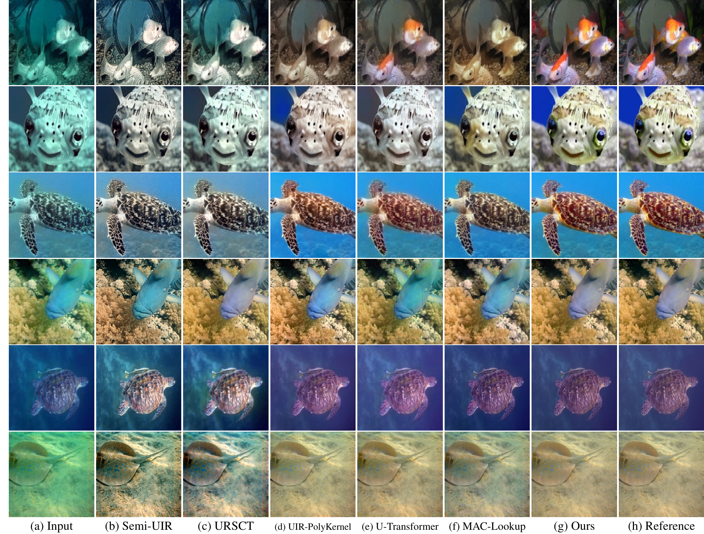
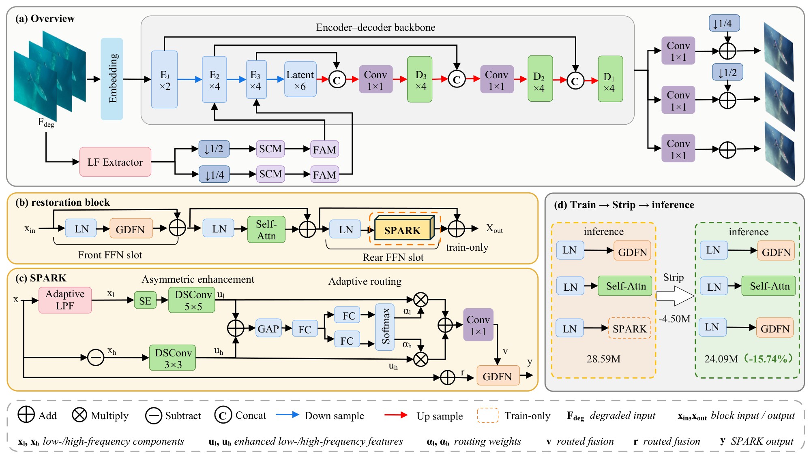

# SandBAR: A Band-Asymmetric Architecture for Underwater Image Restoration with Removable Frequency Scaffolding (WACV 2027 Accepted)

Yanzi Liu, Haoran Hou<sup>†</sup>, Jiachi Tong<sup>†</sup>, Shen Chen<sup>†</sup>, and Shuang Chen<sup>*</sup>

<sup>†</sup> Haoran Hou, Jiachi Tong, and Shen Chen contributed equally. <sup>*</sup> Corresponding author.

[](papers/2026411507.pdf)
[](papers/01450_supp.pdf)
[](https://github.com/YanziLiu/SandBAR/releases/tag/v1.0.0)



*Figure 4. Visual comparison from the paper.*

#### News

- SandBAR has been accepted to **WACV 2027**! 🎉

## Network Architecture



The architecture combines the band-asymmetric sandwich block, SPARK, low-frequency guidance, and a three-scale spatial-frequency objective. PaST trains the model with the SPARK scaffold and removes its auxiliary branches for inference.

## Installation

See [INSTALL.md](INSTALL.md) for the evaluation environment and installation instructions.

## Demo

To restore your own underwater images with the pretrained SandBAR model, see the [demo instructions](docs/USAGE.md#demo).

## Pretrained Model

| Model | Checkpoint | Inference | Evaluation |
|---|:---:|:---:|:---:|
| SandBAR | [Download](https://github.com/YanziLiu/SandBAR/releases/download/v1.0.0/SandBAR_code_and_checkpoint.zip) | [Link](docs/USAGE.md#demo) | [Link](docs/USAGE.md#evaluation) |

## Results

The released deployment checkpoint reproduces the paper's main PSNR results on EUVP, LSUI, and UIEB. The three-domain mean gives equal weight to each domain.

| Dataset | Test images | PSNR (dB) |
|---|---:|---:|
| EUVP | 200 | **29.89** |
| LSUI | 200 | **28.92** |
| UIEB | 90 | **22.77** |
| Three-domain mean | 490 in total | **27.19** |

The deployed model has **24,088,479 parameters**. PaST adds no parameters or FLOPs at inference.

<details>
<summary><strong>Detailed evaluation results</strong> (click to expand)</summary>

| Dataset | PSNR (dB) | SSIM |
|---|---:|---:|
| EUVP | 29.88560774 | 0.90964295 |
| LSUI | 28.92391658 | 0.92160711 |
| UIEB | 22.76943044 | 0.91354280 |
| Three-domain mean | 27.19298492 | 0.91493095 |

Per-image measurements and runtime details are included in [results/reproduced/](results/reproduced/).

</details>

## Citation

If you use SandBAR in your research, please cite:

```bibtex
@inproceedings{liu2027sandbar,
  title={SandBAR: A Band-Asymmetric Architecture for Underwater Image Restoration with Removable Frequency Scaffolding},
  author={Liu, Yanzi and Hou, Haoran and Tong, Jiachi and Chen, Shen and Chen, Shuang},
  booktitle={Proceedings of the IEEE/CVF Winter Conference on Applications of Computer Vision (WACV)},
  year={2027}
}
```


## Contact

For questions, please contact [Yanzi Liu](mailto:yanzi.liu@kcl.ac.uk).

**Acknowledgment:** The implementation includes components adapted from HINT and SFNet. See [THIRD_PARTY_NOTICES.md](THIRD_PARTY_NOTICES.md) for attribution.

The code is released under the [MIT License](LICENSE). Please obtain the benchmark from its original source and follow its data terms.
